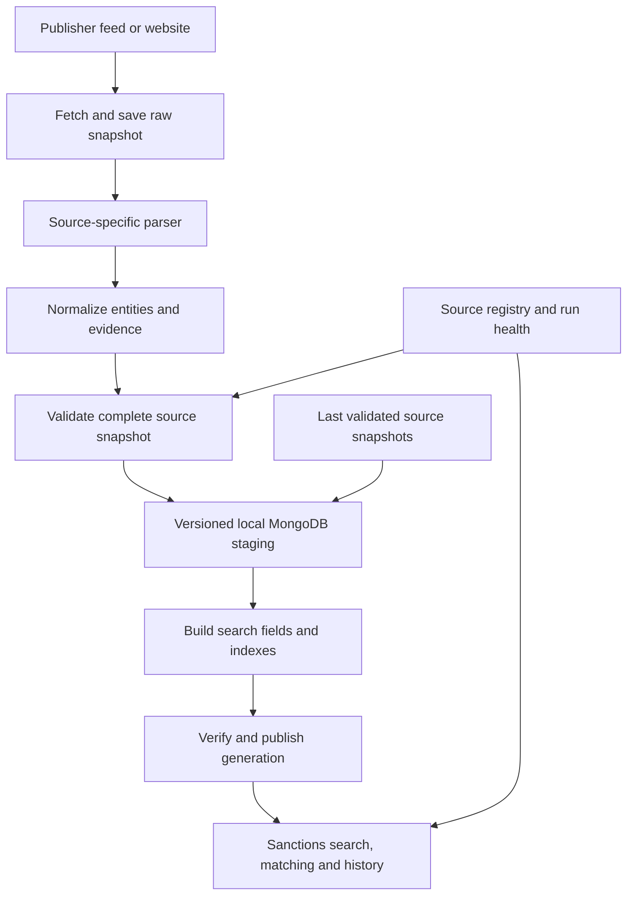

# Independent sanctions and PEP ingestion plan

Status: proposed implementation plan. Prepared 10 November 2026.

This document authorizes no execution. The current request is planning only: do not run crawlers, import records, start services, alter databases, schedule jobs, or deploy. Implementation and a local import would follow a later instruction. Production remains a separate decision after local review.

## Intended outcome

LinkinLegal can continue searching its saved sanctions data when OpenSanctions delivery fails, and can keep supported lists current by fetching their original publishers independently. Search results retain source evidence, aliases, identifiers, listing history, and truthful freshness information.

The scope is the complete inventory of 477 datasets in the supplied CSV. The first delivery prioritizes core sanctions lists; later deliveries cover the remaining sanctions, PEP, and other risk/reference datasets. An initial core fallback must never be described as a complete replacement for all 477 datasets.

Completion means implemented, validated source adapters and verified search behavior, not merely accessible URLs or a parser that accepts a file. A source that remains inaccessible or cannot be reproduced stays explicitly blocked; its records must not be invented or silently dropped.

## Evidence already available

The [link audit](../work/opensanctions-fallback-audit-2026-11-10/report.md) covers all 1,597 distinct URLs in the CSV's four URL columns. [Detailed evidence](../work/opensanctions-fallback-audit-2026-11-10/datasets.json) retains every dataset and its link outcomes. These are point-in-time observations, not parser readiness or availability guarantees.

| Source-data result | Dataset rows |
| --- | ---: |
| Nonempty successful response without a detected challenge | 304 |
| HTTP error | 90 |
| Network, timeout, or TLS error | 45 |
| Possible challenge or denial | 9 |
| Empty response | 2 |
| No source-data URL | 27 |
| Total | 477 |

Within the 304 successful responses, 35 are labelled JSON/XML/CSV/XLSX but return HTML. These need endpoint discovery, request configuration, or source-specific extraction. Those 35 overlap the successful-response count.

Complete-file checks parsed records from UN, EU FSF, UK FCDO XML, Canada, OFAC non-SDN, and OFAC SDN ZIP/XML. Australia DFAT and Swiss SECO downloads timed out here. Pakistan National Assembly and Senate returned HTML; their extraction was not tested. NACTA's data endpoint failed certificate verification with an expired-certificate error.

Three source-data URLs use `data.opensanctions.org`, and eight use OpenSanctions-owned GitHub repositories. Those need original-publisher alternatives or independently controlled copies where appropriate. Hosting our own data pipeline does not recreate OpenSanctions' proprietary entity-resolution decisions or all enrichment.

## Existing application contract

The repository uses MongoDB and FollowTheMoney-style entity records:

- [`sanction.model.ts`](../apps/server/src/modules/sanction-pep/sanction.model.ts): `sanctions-data`.
- [`pep.model.ts`](../apps/server/src/modules/sanction-pep/pep.model.ts): `PEP_data`.
- [`sanction-history.service.ts`](../apps/server/src/modules/sanction-pep/sanction-history.service.ts): reads linked `schema: "Sanction"` statements from the entity collections.
- [`search-names-job.service.ts`](../apps/server/src/modules/public-api/sanctions/search-names-job.service.ts): builds derived search names and identifier keys.
- [`sanction-lists.ts`](../apps/server/src/modules/sanction-pep/sanction-lists.ts), [`pep-sources.ts`](../apps/server/src/modules/sanction-pep/pep-sources.ts), and [`record-kind.ts`](../apps/server/src/modules/sanction-pep/record-kind.ts): determine sanctions scope, PEP scope, and risk labels.

The current entity loader is external to this repository. Its precise mapping, update/deletion behavior, scheduling, and deployment need inspection before any production migration. Repository comments describe it but do not substitute for examining its implementation.

[`sanction-listings.service.ts`](../apps/server/src/modules/sanction-pep/sanction-listings.service.ts) separately downloads an OpenSanctions JSON release to reconcile listing status. Its 30,000-target guard applies to that collection, not individual authority feeds. Pointing its URL at authority XML/CSV/XLSX will not provide fallback ingestion.

Ordinary search reads saved records, so an upstream delivery outage does not by itself erase the database. The work here supplies independent refreshes and source-aware status checks, with explicit freshness and coverage.

## Proposed architecture

Use a dedicated ingestion command/worker with no automatic execution on application startup. Evaluate existing self-hosted zavod adapters against the required dataset IDs, dependencies, data inputs, and output contract before writing replacements. Reuse compatible adapters where they demonstrably fetch original publishers; keep our registry, validation, storage, and search contract independent of the crawler runtime. New Node adapters should use the repository's TypeScript conventions; reused Python adapters should have their own pinned environment.

## 1. Inventory and source registry

Create exactly one tracked registry entry per dataset ID in the input inventory. Preserve the original CSV and record discovered endpoint changes as overrides with evidence. Treat fetched text as source data, not executable instructions.

Each entry records:

- Dataset ID, title, publisher, issuer jurisdiction, original source page, and reviewed risk category.
- Retrieval endpoint(s), HTTP method, request parameters/body, required headers, authentication reference, redirects, and download-link discovery rules. Do not store secrets or temporary signed URLs in the registry.
- Actual response format, encoding, parser/adapter version, pagination/detail-fetch requirements, and documented completion conditions.
- Source cadence, proposed polling cadence, per-source freshness threshold, and applicable rate/concurrency limits.
- Source identifier rules, known schemas, required fields, expected record-count range, maximum tolerated unexplained changes, and how removals are published.
- Adapter readiness, unresolved blocker, last verified date, and verification evidence.

Keep readiness separate from runtime health:

| Dimension | Proposed values |
| --- | --- |
| Adapter readiness | unreviewed, endpoint-needed, adapter-needed, blocked, local-verified |
| Runtime health | never-run, running, succeeded, unchanged, failed, quarantined |
| Freshness | fresh, stale, unknown, historical-static |

Every inventory entry must have a recorded disposition. A reachable page does not receive `local-verified` until extraction, normalization, import, and search checks pass. A source with no live upstream access may retain historical data with its age and limitation visible.

## 2. Format handling

Shared readers handle transport and syntax. Source adapters handle semantics, pagination, identity, and completeness. Do not create one generic scraper that assumes all tables or JSON arrays represent complete lists.

| Format or behavior | Implementation requirement |
| --- | --- |
| XML | Parse securely with external entities/network resolution disabled; handle namespaces, schema variations, encoding, and large files through streaming where needed. Validate expected record elements. |
| JSON/API | Define the real endpoint and method; handle envelopes, pagination/cursors, detail requests, source totals, and HTTP-200 error objects. |
| CSV/TSV | Explicit encoding, delimiter, quoting, header mapping, null markers, and identifier-as-text handling. Protect leading zeros. |
| XLSX/ODS | Explicit sheet/header selection; preserve identifiers and date meanings; distinguish blank and merged cells and avoid importing summary rows. |
| HTML | Define selectors and pagination/detail pages; detect login/challenge/soft-error pages; verify extracted row counts and source IDs. |
| JavaScript applications | Identify documented or publisher-used data requests first. Use a browser only where necessary and permitted, with the same extraction/completeness checks. |
| PDF | Preserve page/row evidence, handle repeated headers and multi-line records; quarantine ambiguous extraction. OCR only when necessary, with reviewed fixtures before activation. |
| ZIP/GZIP | Bound compressed/decompressed size, entry count, expansion ratio, and extraction paths; reject unexpected contents. |
| YAML/static files | Safe parsing and explicit record mapping; version the actual input in controlled storage where needed. |

Transport must use bounded timeouts, retry budgets/backoff, a descriptive User-Agent, conditional requests when supported, and TLS verification. Do not bypass expired certificates or access challenges to mark a source working. Distinguish transient failure from a permanent endpoint change.

Archive only complete downloads. A partial download, HTTP 304 without a matching validated cache, missing final page, or parser-rejected row must not be treated as a complete refreshed list. Source adapters must define whether any rejected record blocks publication; identity/listing-critical errors always do.

## 3. Local storage design

### Environment isolation

Use a dedicated loopback-only MongoDB instance or an explicitly isolated local database, provisionally named `linkinlegal_sanctions_local`. The importer requires an explicit local URI and rejects non-loopback hosts, `mongodb+srv`, and unexpected database names. It must not default to `apps/server/.env` or share production credentials. Local snapshots, database files, and crawled payloads stay outside version control.

All proposed commands are inactive until implemented and explicitly requested. Record the exact local storage location, connection configuration without credentials, and start/stop/reset instructions in the implementation README.

### Raw snapshots

Store original bytes under a local content-addressed directory, for example `data/sanctions/raw/<dataset-id>/<sha256>.<extension>`, with a metadata sidecar. A later production implementation can replace the filesystem backend with private object storage without changing parser behavior.

Metadata includes original URL, safe redirect information, fetch start/end time, HTTP status, content type, ETag/Last-Modified when available, content hash, bytes, and parser version. Redact secrets and expiring signed query parameters. Reprocessing a saved raw snapshot must not require another network request.

### MongoDB records

Proposed authoritative collections:

| Collection | Purpose and key constraints |
| --- | --- |
| `sanction_source_registry` | Source configuration/version references; unique dataset ID. |
| `sanction_ingest_runs` | Attempt status, errors, counts, checks, and last success; unique run ID. |
| `sanction_source_snapshots` | Validated snapshot metadata and immutable normalized source-record references; unique source/snapshot ID. |
| `sanction_source_records` | Source-specific normalized records and evidence; unique source/snapshot/source-record ID. |
| `sanction_entity_crosswalk` | Source IDs and existing provider IDs mapped to stable internal entity IDs, with decision/evidence history. |
| `sanction_dataset_generations` | Published generation manifest, source snapshot versions, collection mapping, and readiness. |

Search collections remain compatible with the existing `sanctions-data` and `PEP_data` record shapes. Build versioned materialized collections per generation, containing entities and linked statements, rather than partially updating live search records during parsing.

Use one manifest to identify a complete generation: sanctions records, PEP records, listing-status projection, source classifications, filter metadata, and search index readiness. Resolve that manifest once per request/job. This requires an explicit collection/model resolver in the application; the current fixed Mongoose collection bindings do not already support it. Retain the previous generation for rollback and in-flight readers. Do not assume renaming several collections is atomic.

Start local development with the baseline application's collection names inside the isolated database if needed. The generation resolver and rollback must pass before any production proposal.

## 4. Normalized entity and evidence contract

Populate the current application fields: `id`, `caption`, `schema`, `properties` as string arrays, `datasets`, `referents`, `target`, `first_seen`, `last_seen`, and `last_change`. Generate `search_names` and `search_keys` with the existing shared builders. Add provenance through the authoritative source-record collections rather than relying on the existing Mongoose schema to retain undeclared fields.

Normalization rules:

- Preserve original names/scripts, aliases and their quality, identifiers, nationality, addresses, and the source's actual entity type. Normalize for search in derived fields; never overwrite original evidence.
- Keep unknown/partial birth dates as unknown/partial dates. Do not invent a day/month or infer nationality from the authority's country.
- Preserve explicit sanctions regime, authority, reason, measure type, source URL, and effective dates in linked `Sanction` statements. `properties.entity` references the stable entity ID used by the existing history reader.
- Preserve PEP positions, occupancies, relationships and term dates where available. Keep other risk/reference records accurately classified.
- A `target` flag is a screening-selection flag, not sufficient proof that someone is currently sanctioned. Determine current listing status from per-source evidence and validated snapshots.
- Distinguish observation clocks from source-effective dates. `first_seen` persists across imports; `last_seen` advances only when observed in a complete successful snapshot; `last_change` advances for semantic content changes. Store source publication and fetch times separately.

### Identity and deduplication

Use a source-scoped stable ID for each source record, based on the publisher's durable identifier. Maintain a stable internal entity ID and persistent source-to-entity crosswalk. When no durable source ID exists, define a reviewed source-specific identity recipe and collision checks; a name hash alone is insufficient.

Deduplicate repeat records within one source deterministically. Cross-source merges require strong, documented evidence such as matching authoritative identifiers; ambiguous matches remain separate and reviewable. Preserve existing OpenSanctions IDs as provider mappings/referents only when verified. Never pretend independently produced IDs match its merged IDs.

Document the initial behavior for unresolved cross-source duplicates: return source-scoped records with clear provenance and avoid asserting that record counts equal unique people. A complete merged-profile replacement requires a separate resolution-quality acceptance gate.

## 5. Publishing, removals, and fallback

Make the independent pipeline maintain its own validated source snapshots. OpenSanctions can remain an optional richer provider during comparison. Provider outages must not silently change historical facts or reduce an entity's other source evidence.

| Event | Required behavior |
| --- | --- |
| First valid source snapshot | Stage, validate, build search projections, and publish only after readiness checks pass. |
| Successful changed snapshot | Compute additions/changes/removals within that source; publish a new generation with stable entity IDs. |
| Successful unchanged snapshot/valid conditional response | Update source-run health while retaining the same validated content. |
| Fetch, TLS, format, schema, pagination or validation failure | Quarantine the attempt and retain the last validated source snapshot. Show its age and error. |
| No prior valid source snapshot | Mark source unavailable; never interpret it as an empty valid list. |
| One source no longer lists a party | End that source's membership only after a complete validated comparison. Keep other authorities' active evidence. |
| Record disappears without an effective removal date | Record the observed disappearance and observation interval; do not invent a legal delisting date. |
| Source re-lists a party | Preserve prior membership history and create the new active period. |
| OpenSanctions delivery fails | Continue searches against the published local generation; use independently validated snapshots for covered sources and expose gaps/staleness. |
| Provider recovers | Compare in shadow mode and reconcile IDs/evidence before a controlled provider change; do not overwrite direct-source history blindly. |

Replace the OpenSanctions-only reconciliation assumption with a provider/source-aware listing projection. The external loader and direct ingestion must never concurrently own the same materialized search collections. A smaller core generation must not overwrite a broader existing generation as though coverage were equal.

## 6. Search and application integration

Keep current API response contracts unless a documented freshness/coverage extension is necessary. Integrate:

- Name/caption search and every retained alias, with original-script and existing transliteration behavior.
- Identifier search using the current shared key normalization; preserve passport/registration numbers, IMO numbers, and other identifiers as text.
- Dataset, country, schema, date and sanctions/PEP filters, plus record-kind labels.
- Entity details, linked sanctions history, reports, batch matching, and other consumers that resolve the current models.
- Dataset description/country/schema metadata tied to the same published generation.
- Per-source last-success and snapshot-age information. One global newest `last_change` must not make a failed source look fresh.

Build derived fields during staging and run the existing refresh logic as needed; do not wait until the next fixed daily cron for new records to become matchable.

A plain local MongoDB does not provide the production Atlas Search indexes. Local tests must explicitly exercise a supported local retrieval path, including alias and identifier recall, without claiming production ranking parity. Any portable retrieval changes need review against existing search scope and performance limits. Test the Atlas path separately in an approved non-production Atlas environment before a production proposal.

## 7. Delivery sequence and gates

| Phase | Deliverable | Exit evidence |
| --- | --- | --- |
| A. Inventory | Registry entries for all 477 sources, independent-input classification, endpoint/method overrides, blockers, and adapter reuse assessment. | Inventory reconciles exactly; every source has a disposition and risk category. |
| B. Local foundation | Explicit local-only CLI/configuration, raw snapshot store, run ledger, normalized contracts, crosswalk, staging and publish/rollback mechanism. | Remote connection rejection and failure-isolation tests pass; no automatic scraper startup. |
| C. Core sanctions | UN, EU FSF, UK FCDO, OFAC SDN/non-SDN, Canada adapters. | Each parses a real snapshot, preserves required evidence, imports locally, and passes search/history checks. |
| D. Remaining sanctions | Australia, Switzerland, Pakistan NACTA, remaining sanctions/export/terrorism sources according to reviewed scope. | Source blockers resolved or explicitly recorded; no silent coverage loss or misclassification. |
| E. PEP and other sources | Remaining PEP, debarment, regulatory, maritime and reference adapters; positions/relationships and source-specific formats. | Each source meets its extraction and search contract; non-sanctions are labelled correctly. |
| F. Integrated local review | Published local dataset, source coverage report, search verification, replay, outage and rollback demonstrations. | Acceptance checklist below passes for the claimed coverage; unresolved sources remain visible. |
| G. Production proposal | Concrete deployment, migration/backfill, ownership, resource estimates, monitoring and rollback proposal based on measured local results. | User reviews the result and separately decides whether to proceed to production. |

Prioritize core sanctions for useful early review, but keep all 477 entries in the progress report throughout. Do not declare Phase F a full inventory replacement while required sources remain blocked or unimplemented.

## 8. Verification and acceptance

Use small reviewed fixtures for edge cases and saved real source snapshots for integration/replay. Do not manufacture test records inside the searchable real dataset.

Required checks:

1. **Coverage:** exactly 477 inventory dispositions; separately report downloaded, fully parsed, validated, published, blocked, historical-only, and unimplemented sources. Reconcile unique source IDs, rejected records, pagination totals and normalized output counts.
2. **Extraction correctness:** reviewed examples for names, aliases, original scripts, birth dates, identifiers, entity types, listing dates/status and reasons. Test encoding changes, multi-line cells, namespaces, malformed/partial files, HTTP-200 error pages and missing last pages.
3. **Storage:** identical snapshot replay is idempotent; no duplicate source records, statements, or crosswalk entries; semantic timestamps remain stable; source failures do not delete published data.
4. **Identity:** same name/different people stay distinct; conflicting identifiers trigger review; verified provider mappings preserve stable internal IDs through provider switching and source renumbering.
5. **History:** additions, amendments, removal, re-listing, and one-of-several-authority removals preserve correct source membership and evidence. Failed snapshots never cause mass delistings.
6. **Search:** known entries are found by primary name, non-primary aliases, original script, supported transliteration and identifiers. Filters, labels, details, history and matching use the same generation. Unrelated PEP/reference entries must not be described as sanctioned.
7. **Atomicity:** interrupt fetch, parsing, staging, index creation and publishing. Readers retain a complete previous generation; a successful switch exposes one consistent new generation. Rollback restores the previous searchable generation and metadata.
8. **Outage:** disable OpenSanctions delivery and replay/import the independent snapshots. Demonstrate searchable additions/updates for supported authorities; expose unsupported or stale sources. A source without a validated snapshot must show unknown/unavailable coverage.
9. **Recovery:** simulate direct-source failure and recovery plus provider recovery. Confirm backoff, run resumption, no duplicate jobs, and no uncontrolled provider overwrite.
10. **Performance:** measure import duration, disk/memory, index size, search latency and recall on the actual local dataset. Set documented operational targets from measured baseline/application needs; verify any Atlas-specific behavior separately.

Expected local review artifacts: coverage matrix for every source, raw snapshot manifests/hashes, normalized-record validation counts, local database and published generation details, reproducible test results, representative source-to-search evidence, blocker list, and replay/rollback instructions.

No result should be called perfect or a complete OpenSanctions replacement based on link access, file syntax, core-list coverage, or aggregate record counts alone.

## Proposed code organization

Paths below are proposals, not files implemented by this planning task:

- `apps/server/src/modules/sanction-pep/ingestion/`: registry, normalized contracts, source adapters, fetch/archive, validation, identity mapping, persistence, projection, publication, source health.
- `apps/server/src/scripts/sanctions-local.ts`: explicit local CLI with inventory, fetch, replay, validate, publish, status, search-check and rollback subcommands.
- `apps/server/src/modules/sanction-pep/ingestion/**/*.test.ts`: parser, validation, identity, membership and publish tests.
- `apps/server/tests/sanctions-local-ingestion.test.ts`: isolated local database and search integration tests.
- Separate pinned Python crawler runtime only if the adapter reuse assessment justifies it; record its outputs and versions at the same normalized boundary.
- Update existing search/model consumers through a generation resolver, and update source-aware listing reconciliation and search refresh orchestration.
- Local raw data and database storage paths excluded from version control; commit only configuration schemas, reviewed fixtures, adapters, tests and documentation.

Before implementing production changes, inventory all readers of the existing models/collections, including API, UI, reports, digests, screenings and scheduled jobs. Adapt and verify these consumers so ingestion does not produce data that only a standalone demo can search.
